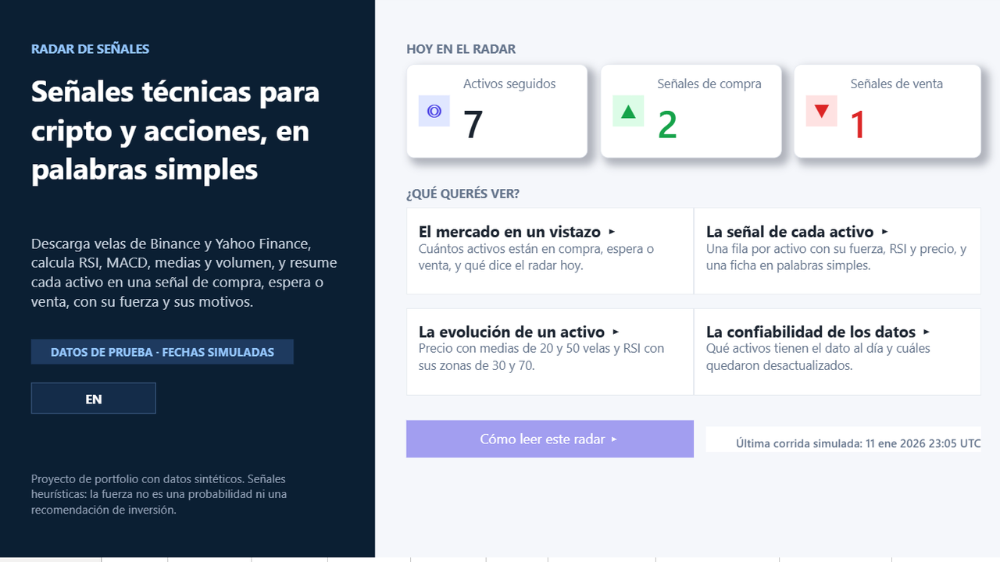
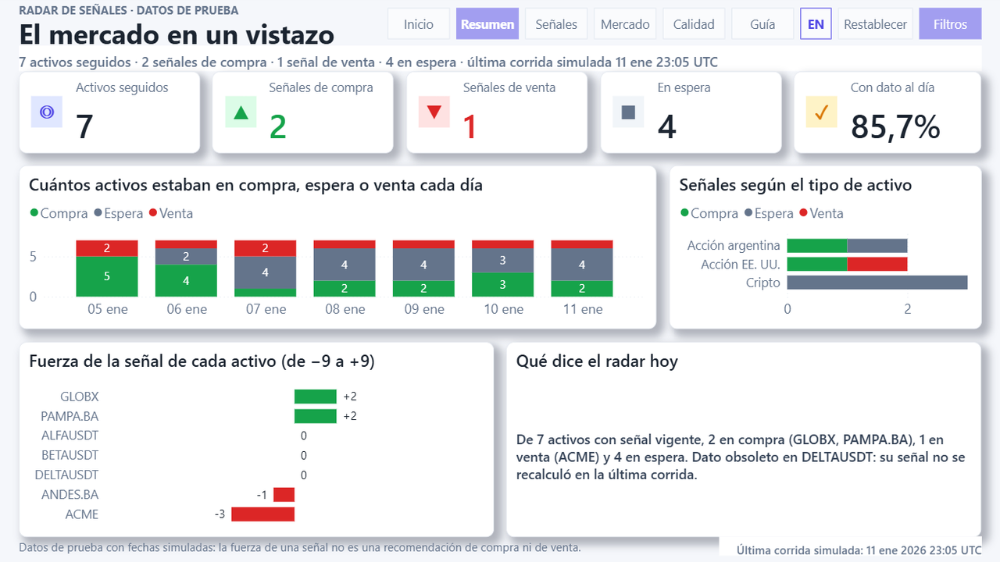
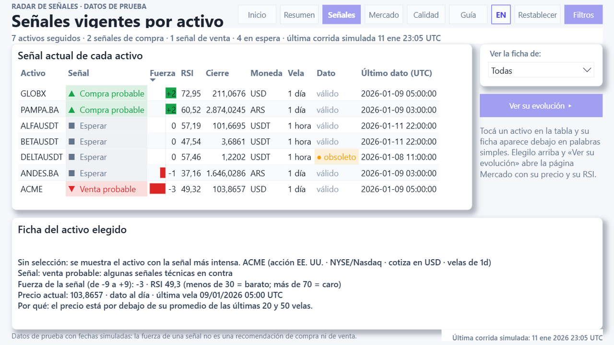
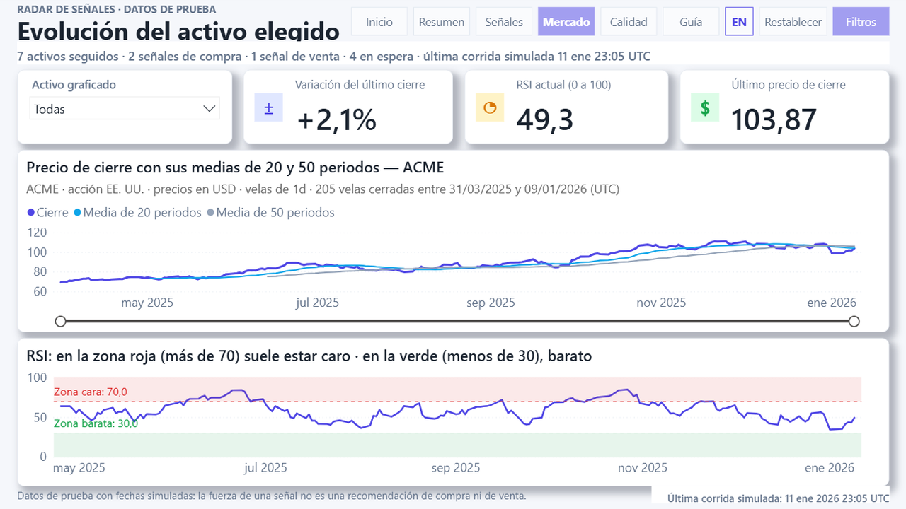
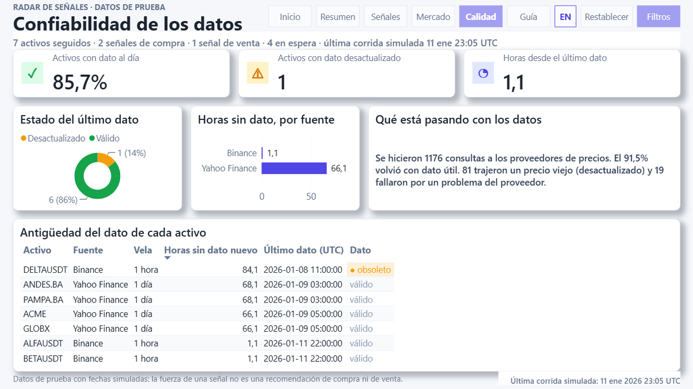
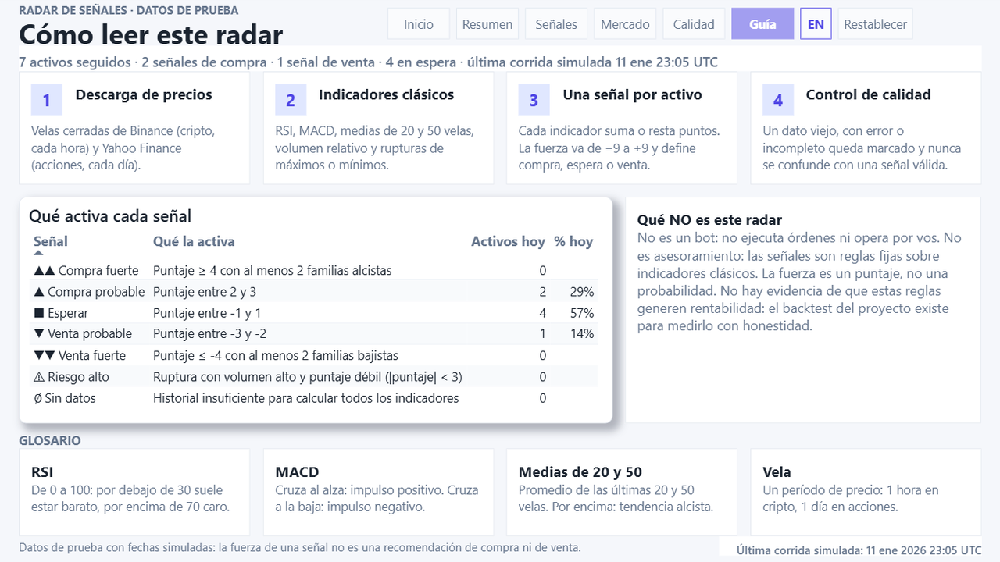
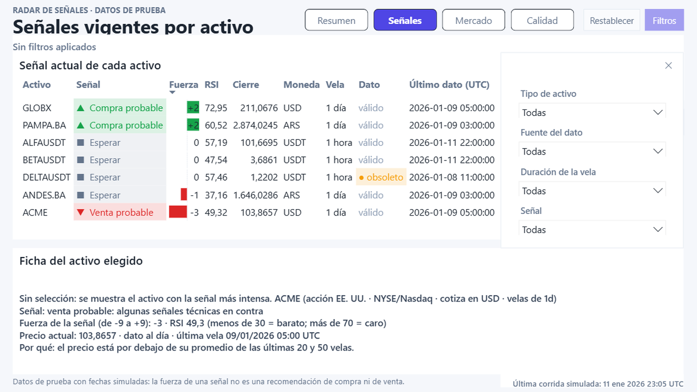
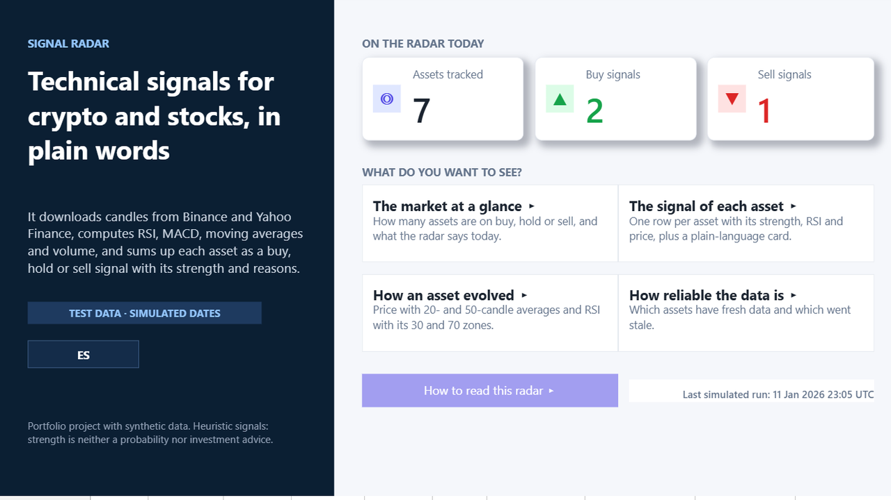
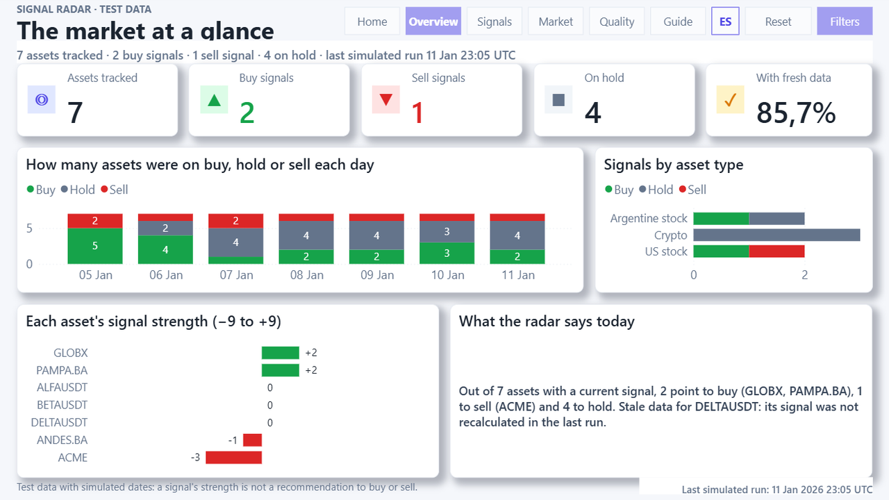

# Demo pública de Power BI — proyecto `RadarDemo` (PBIP, español / inglés)

Informe de Power BI construido **solo** con los CSV sintéticos de `powerbi/datos_demo/`
(hashes en `powerbi/datos_demo/MANIFIESTO.txt`). No contiene posiciones, saldos, tokens,
rutas personales ni notas: el modelo no incluye ninguna tabla privada y `dim_activo[es_sintetico]`
es `TRUE` en todas las filas.

> Señales heurísticas; `fuerza` es un puntaje de −9 a +9, no una probabilidad; no es recomendación
> de inversión. Las fechas de la demo son de corridas simuladas (enero de 2026) y el pie de cada
> página lo recuerda.



| Resumen | Señales |
|---|---|
|  |  |

| Mercado | Calidad |
|---|---|
|  |  |

| Guía | Panel de filtros |
|---|---|
|  |  |

| Home (EN) | Overview (EN) |
|---|---|
|  |  |

## Contenido

```
powerbi/demo_publica/
├── RadarDemo.pbip                       # punto de entrada (abrir con Power BI Desktop)
├── RadarDemo.SemanticModel/             # modelo semántico en TMDL
│   ├── definition.pbism, .platform
│   ├── .pbi/editorSettings.json         # autodetección de relaciones y de tipos: desactivadas
│   └── definition/
│       ├── model.tmdl                   # es-AR, fecha/hora automática desactivada, sin medidas implícitas
│       ├── expressions.tmdl             # parámetro CarpetaDatos + función CargarCsv (cultura en-US)
│       ├── relationships.tmdl           # 9 relaciones muchos a uno, filtro en una dirección
│       └── tables/                      # dim_activo, dim_fecha, dim_senal, dim_corrida,
│                                        # fact_senales, fact_precios, fact_resultados_activo, _Medidas
├── RadarDemo.Report/                    # informe en PBIR: 6 páginas en español + las mismas 6 en inglés (ocultas)
│   ├── definition.pbir                  # byPath -> ../RadarDemo.SemanticModel
│   ├── definition/pages/...             # Inicio, Resumen, Señales, Mercado, Calidad, Guía (ES) + Home … Guide (EN)
│   ├── definition/bookmarks/            # abrir/cerrar el panel de filtros, por página
│   └── StaticResources/RegisteredResources/RadarTheme.json   # tema
├── gen_report.py                        # el informe se genera desde código en los dos idiomas (diccionario EN)
├── exportar_medidas.py                  # exporta las medidas del TMDL a ../medidas.dax
├── VALIDACION_MEDIDAS.dax               # consulta con las 88 medidas por activo (Vista de consultas DAX)
└── capturas/                            # lienzo de cada página (1280 × 720) capturado en Desktop
```

## Abrir y actualizar

1. Power BI Desktop (probado con la versión de Microsoft Store 2.159). Abrí `RadarDemo.pbip`.
2. El parámetro `CarpetaDatos` apunta a `D:\radar_senales\powerbi\datos_demo\`. Si clonaste el
   repositorio en otra carpeta, cambialo (*Transformar datos → Editar parámetros*, o editá
   `expressions.tmdl` antes de abrir). Debe terminar en `\`.
3. *Inicio → Actualizar*. Los CSV se leen con `Csv.Document` en UTF-8 y los tipos se aplican con
   cultura `en-US` (punto decimal, fechas ISO), así que funciona con cualquier configuración regional.
4. En la vista de edición de Desktop los botones (navegación, «Filtros», «Restablecer», «Ver su
   evolución») se activan con **Ctrl + clic**; en el Service o en modo lectura, con clic.
5. Al guardar, Desktop reescribe los archivos del proyecto en su propio formato (equivalente) y
   agrega `.pbi/localSettings.json` y `cache.abf`, ambos ignorados por git.

## El informe se genera desde código, en dos idiomas

`gen_report.py` escribe todos los `visual.json`, `page.json`, marcadores y el tema a partir de una
cuadrícula de 1280 × 720 (posiciones múltiplos de 8 px, margen 24, separación 16). Cada página se construye dos
veces: en español y en inglés. Los textos de la interfaz salen del diccionario `EN`, las medidas que producen
texto tienen su versión en inglés en el modelo (`EN_MEASURES`, p. ej. `Radar reading`, `Selected asset detail`)
y los selectores y ejes usan columnas en palabras en inglés (`EN_COLS`, p. ej. `dim_activo[Asset type]`). Si
un texto queda sin traducir, el generador se detiene y lo lista. El botón **EN / ES** de la cabecera (y de la
portada) lleva a la misma página en el otro idioma; las páginas en inglés están ocultas en la barra de pestañas
para no duplicar la navegación. Para cambiar el
diseño se edita el generador y se vuelve a correr con Desktop cerrado (hace un respaldo en la carpeta
temporal del sistema):

```bash
python powerbi/demo_publica/gen_report.py
python powerbi/demo_publica/exportar_medidas.py   # mantiene ../medidas.dax sincronizado con el TMDL
```

Convenciones que el generador aplica y que Desktop 2.159 exige (aprendidas a prueba y error):

- Botones: el vínculo lleva `showDefaultTooltip`; `'Drillthrough'` va con t minúscula (la T mayúscula deja el
  informe en blanco). Un botón transparente (`fill.transparency` 100, texto oculto) hace clicable toda una tarjeta.
- Formas con texto: márgenes en 0 y texto corto; el texto que no entra se corta con «…» sin aviso.
- Texto largo derivado de una medida: `cardVisual` con `textWrap` (ajusta línea y alinea a la izquierda si
  la altura alcanza). `multiRowCard` no ajusta línea y `shape` no acepta medidas.
- Selectores: el tamaño de fuente del encabezado y de los ítems se llama `textSize`.
- Formas (`shape`): relleno, contorno y texto escritos dos veces (sin selector y con `id: default`).
- Restablecer: botón `ClearAllSlicers`; un marcador con `remove general.filter` no limpia selectores sincronizados.
- Zonas del RSI: `y1AxisReferenceLine` con `shadeShow`, `shadeRegion` (`after` = por encima, `before` = por debajo) y `shadeTransparency`; evita series auxiliares.
- Estados de botón: selectores `hover` y `pressed` en `fill`/`text`, `glow` en hover para los primarios. En Desktop (modo edición) los botones y las tarjetas clicables requieren Ctrl + clic; en el servicio basta el clic.

## Modelo

- **Estrella**: `dim_activo[ticker]`, `dim_fecha[fecha]`, `dim_senal[señal]` y `dim_corrida[run_id]`
  filtran a `fact_senales`, `fact_precios` y `fact_resultados_activo`. No hay relaciones entre hechos.
  `dim_fecha` está marcada como tabla de fechas; `dim_senal[señal]` se ordena por `orden`.
- **Protecciones contra sumas sin sentido**: `discourageImplicitMeasures` (ninguna columna se agrega
  desde el panel de campos), columnas técnicas (`id`, `es_ultima`, `es_ultima_vela`, `cambio_senal`,
  claves foráneas de los hechos) ocultas, `summarizeBy: none` en todas las columnas no aditivas.
- **Columnas calculadas en palabras simples** (para selectores, ejes y tablas): `dim_activo[Tipo de activo]`
  (Cripto, Acción argentina, Acción EE. UU.), `[Fuente de datos]` (Binance, Yahoo Finance), `[Vela]`
  (1 hora, 1 día); `fact_senales[Estado del dato]` (Válido, Desactualizado, …) y `[Día de corrida]`;
  `dim_senal[Señal en palabras]` (▲▲ Compra fuerte … ∅ Sin datos). Cada una tiene su par en inglés
  (`Asset type`, `Data source`, `Candle`, `Data status`, `Run day`, `Signal`, `Rule`).
- **Medidas** (`_Medidas`, 88; todas documentadas en `powerbi/medidas.dax`, agrupadas por carpeta):
  señal actual y conteos por activo; frescura y calidad (tasa de datos válidos, corridas por estado,
  errores de proveedor); historia (activos en compra / espera / venta por día de corrida, cambios de
  señal, series por vela para Mercado); lecturas en texto (`Lectura del radar`, `Detalle del activo
  seleccionado`, `Lectura de calidad`, que describen conteos y traducen los motivos técnicos a lenguaje
  cotidiano); y formato (colores por señal, estado y signo de la fuerza; títulos y subtítulos dinámicos).

  Ninguna suma ni promedia RSI, fuerza o precios: el RSI que se muestra es `RSI última vela`
  (MAX sobre la única vela marcada `es_ultima_vela`) o `RSI (vela)` por vela. Las tarjetas cuentan
  `DISTINCTCOUNT(fact_senales[ticker])` con `es_ultima = TRUE`, nunca filas de precios.

## Diseño

Estilo de tablero SaaS moderno: fondo gris muy suave (`#F5F7FB`), tarjetas blancas sin bordes ni sombras,
tipografía Segoe UI, un solo color de acento (índigo `#4F46E5`) y colores semánticos únicamente para
compra (verde), venta (rojo), espera (gris) y dato desactualizado (ámbar). Cabecera repetida en todas las
páginas: marca, título en palabras de todos los días, subtítulo con los filtros activos, navegación en
píldoras, «Restablecer» y «Filtros» (abre un panel con selectores de tipo de activo, fuente, duración de
la vela y señal). Sin filtros, el subtítulo muestra el resumen del día (activos, señales, última corrida). Tarjetas
blancas con borde redondeado y sombra suave; KPI con ícono en un tile de color y clicables (al pasar el mouse se
resaltan con borde índigo y llevan a la página de detalle); botones con estado al pasar el mouse; tablas con filas
alternadas. La portada usa un panel azul
marino con el título y la bajada del proyecto. Pie con el aviso de datos de prueba y la fecha de la última corrida.
Cuadrícula de 8 px, textos ≥ 11 pt, contraste de texto ≥ 4,5:1, símbolo además de color en cada señal,
texto alternativo y orden de tabulación en cada visual.

## Páginas (1280 × 720, cada una en español y en inglés)

| Página | Pregunta | Contenido |
|---|---|---|
| **Inicio** | ¿Qué es esto? | Portada: qué hace el radar, tres números de hoy (activos seguidos, señales de compra y de venta) y cuatro tarjetas clicables que llevan a cada página, más la guía de lectura. |
| **Resumen** | ¿Qué está detectando el radar? | Cinco tarjetas con ícono (activos seguidos, señales de compra, señales de venta, en espera, con dato al día); columnas apiladas de activos en compra / espera / venta al cierre de cada día simulado; señales por tipo de activo; barras divergentes con la fuerza de cada activo (−9 a +9, verde/rojo); «Qué dice el radar hoy» en texto. |
| **Señales** | ¿Qué activos explican ese panorama? | Tabla con una fila por activo: señal con símbolo, fuerza (barras de datos), RSI y cierre de la última vela, moneda, vela, estado del dato (tinte ámbar si está desactualizado) y hora del dato. Selector «Ver la ficha de» (sincronizado con Mercado), botón «Ver su evolución» y «Ficha del activo elegido»: contexto, señal, fuerza, RSI, precio y motivos traducidos a lenguaje simple (sin selección, el activo con la señal más intensa). |
| **Mercado** | ¿Cómo evolucionó el activo elegido? | Selector de activo (uno a la vez, sincronizado con Señales) y tres tarjetas (variación del último cierre, RSI, último precio). Cierre con medias de 20 y 50 velas y deslizador de zoom en el tiempo; RSI (14) con las zonas de más de 70 (rojo) y menos de 30 (verde) sombreadas y eje 0–100. Títulos dinámicos con el activo. Sin selección muestra el primer activo visible. |
| **Calidad** | ¿Cuánto puedo confiar en lo que veo? | Activos con dato al día, con dato desactualizado y horas desde el último dato; dona por estado del último dato; antigüedad por fuente; «Qué está pasando con los datos» en texto; tabla de antigüedad del dato de cada activo. |
| **Guía** | ¿Cómo se lee? | Los cuatro pasos del radar (descarga, indicadores, señal, calidad), la tabla «Qué activa cada señal» con las siete reglas y cuántos activos tienen cada una hoy, «Qué NO es este radar» y un glosario (RSI, MACD, medias, vela). |

Interacción: los visuales se filtran entre sí; los selectores del panel no se filtran entre ellos;
«Restablecer» usa la acción nativa *Borrar todas las segmentaciones* (un marcador que quita el filtro no
limpia selectores sincronizados);
el selector de activo de Señales y el de Mercado pertenecen al mismo grupo de sincronización, así que
elegir un activo en una página lo deja elegido en la otra.

## Qué se validó (22 de octubre de 2026)

- **Sintaxis del modelo**: `TmdlSerializer` de TOM (SQL Server 2025) parsea la carpeta sin errores
  (8 tablas, 9 relaciones, 88 medidas).
- **Estructura del informe**: `pbir validate --all` (esquemas, campos contra el modelo, QA): 0 errores.
  Las advertencias restantes son solapes intencionales (panel de filtros sobre la página), selectores
  ocultos hasta abrir el panel y avisos del catálogo de propiedades (advisory). `tests/test_pbip.py`
  repite los chequeos estáticos en CI sin Desktop: JSON válido, cuadrícula y lienzo, campos y medidas
  existentes en el TMDL, serialización de botones y tooltips, texto alternativo, ausencia de tablas
  privadas y rutas personales, y que `medidas.dax` coincide con el modelo.
- **Motor local de Desktop (ADOMD.NET)**: las 88 medidas se evaluaron sin filtros, con un activo
  (ACME) y con una fecha: 0 errores. Sin filtros, los valores coinciden con `powerbi/valores_esperados.md`
  (7 activos con señal vigente: 2 compra / 1 venta / 4 espera; 6 con dato válido; última corrida
  2026-01-11 23:05 UTC, parcial; 168 corridas; 1157 señales; tasa de datos válidos 91,5 %).
- **Render e interacción en Desktop 2.159** (clics automatizados sobre el lienzo, con captura de cada
  paso): las cuatro páginas sin textos cortados ni tablas con scroll; seleccionar una fila actualiza la
  ficha; elegir un activo en «Ver la ficha de» lo deja elegido en Mercado; «Ver su evolución» navega a
  Mercado; «Filtros» abre y cierra el panel; «Restablecer» limpia los selectores.

Lo que **no** se validó o quedó fuera:

- En las páginas en inglés, los números de tablas y tarjetas conservan el formato regional del modelo (es-AR:
  coma decimal y punto de miles) y el desplegable de los selectores dice «Todas» en Desktop: Power BI aplica
  una sola cultura por modelo. Los textos generados por medidas sí usan formato en-US.
- Al cambiar de idioma se conserva el activo elegido (grupo de sincronización compartido) pero los filtros del
  panel se reinician: cada idioma usa sus propias columnas en palabras.

- Publicación en Power BI Service (gateway / actualización programada) y otras resoluciones.

## Control de versiones

El `.gitignore` de la raíz excluye los archivos PBIP por defecto, pero permite explícitamente
`powerbi/demo_publica/RadarDemo.pbip`. También mantiene fuera los cachés locales
`**/.pbi/localSettings.json` y `**/.pbi/cache.abf`; el `editorSettings.json` de esta demo sí se
incluye como configuración reproducible. El PBIX privado, `output/`, credenciales, bases de datos
y archivos personales continúan excluidos.
